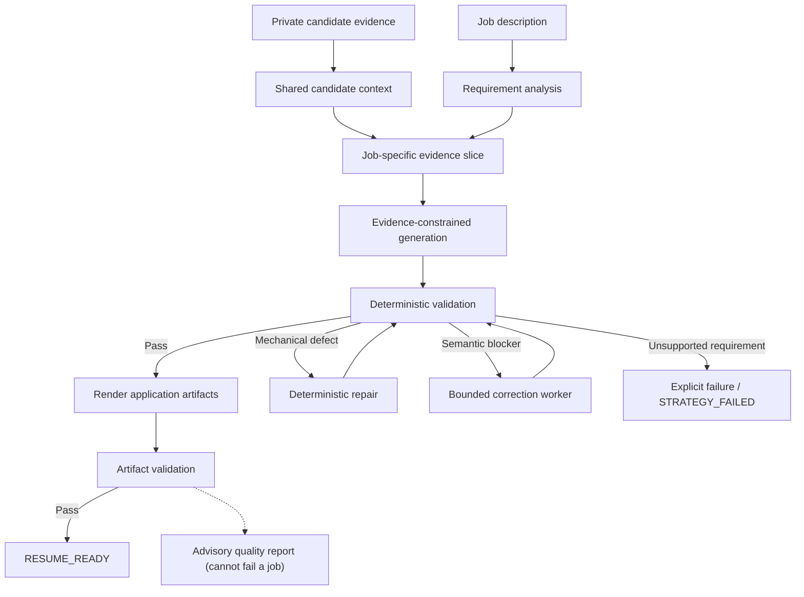

# AI Resume Application Pipeline

An evidence-grounded, validation-first system for generating job-specific
resumes and cover letters from a candidate's own verified facts.

The system is built around one rule:

> **Same experience, different emphasis.**

It tailors how verified experience is *presented* for a given job. It does not
invent qualifications, projects, metrics, tools, or employment history to
satisfy a job description. When the available evidence genuinely cannot support
a job's requirements, the pipeline is designed to fail that job explicitly
rather than fabricate a fit.

---

## Start here

**New to this repository? Read
[`docs/GETTING_STARTED.md`](docs/GETTING_STARTED.md).** It is a numbered
checklist that takes you from a fresh clone to a rendered resume, with the
exact commands in order.

Other entry points:

- [`INSTRUCTIONS.md`](INSTRUCTIONS.md) — field-by-field reference for the
  candidate data files.
- [`tools/resume/v86/README.md`](tools/resume/v86/README.md) — the batch
  pipeline's own implementation reference.
- [`docs/`](docs/) — design documents for each subsystem.

---

## What is in this repository

Four things, in dependency order:

| Area | Entry point | What it does |
| --- | --- | --- |
| **Batch pipeline (V8.6.x)** | `tools/resume/v86/run_batch.py` | Turns a directory of job-description Markdown files into rendered resumes and cover letters, with deterministic validation and bounded correction between the model calls. |
| **Advisory diagnostics (V8.6.9)** | `resume_quality_report` (in-run); three standalone CLIs | Explain a finished resume without gating it. Only `resume_quality_report.json` is written during a batch run. The JD-match report, recommendation guard, and template style audit are **standalone commands you run yourself** — the pipeline never invokes them. |
| **Job intake (V1, offline)** | `tools/intake/run_intake.py` | Classifies and de-duplicates job URLs, writes normalized postings into the batch inbox, and maintains an `Intake` worksheet. Live scraping is not wired up. |
| **Setup and validation tools** | `tools/bootstrap_candidate.py`, `tools/validate_candidate_setup.py`, `tools/resume/v8/runtime_context_guard.py` | Create a starting candidate dataset from the committed fictional examples, check it before any paid call, and detect when the runtime context has gone stale. |

The runtime pipeline is candidate-agnostic: no employer, university, or
project identity is hardcoded in the application logic. Candidate behaviour is
driven by the private configuration under `master/` and `reference/` through
fields such as `tailoring_mode` and `project_status`. Everything committed here
— examples, fixtures, templates — uses fictional entities.

### Finalization and watermark cleaning

The last stage of every job hands the rendered `resume.docx`, `resume.pdf`,
`cover_letter.docx`, and `cover_letter.pdf` to a local watermark-cleaning HTTP
service (`tools/resume/v86/finalize_local.py`, deterministic — no model call).
It saves each original first and promotes a cleaned file only when the
extracted text is identical and the resume PDF is still exactly one page;
otherwise the original is kept. The service is health-checked once per batch,
and when it is not running finalization is skipped silently — the job still
completes and the tracker records `Watermark Status` as `NOT STARTED`.

For real runs, `scripts/run_batch_with_cleaning.sh` refuses to start a batch
unless the service is healthy and then verifies that every job was actually
finalized. The service itself is a separate open-source project that is not
vendored here; its README lists `GET /health`, `GET /capabilities`,
`POST /inspect`, and `POST /clean`, which are the four endpoints this finalizer
calls, so a substitute service must provide all four — otherwise artifacts are
reported as `FAILED` and the wrapper exits `2`. Check the upstream README and
license yourself. See
[**Watermark cleaning**](docs/GETTING_STARTED.md#9-watermark-cleaning-recommended-before-real-runs)
in the getting-started guide for setup, the exact checks, and the limits.

---

## Why this is not just an LLM wrapper

A naive resume generator can be summarized as:

```text
job description + candidate profile -> LLM -> resume
```

This project treats generation as only one stage in a larger controlled system:

```text
candidate evidence
      |
      v
structured retrieval / grounding
      |
      v
job requirements analysis
      |
      v
evidence-constrained generation
      |
      v
deterministic validation
      |
      +---- pass --------------------+
      |                              |
      |                              v
      |                         render artifacts
      |                              |
      |                              v
      |                       artifact validation
      |                              |
      |                              v
      |                         RESUME_READY
      |
      +---- blocker
             |
             +-- deterministic repair when possible
             |
             +-- bounded semantic correction when necessary
             |
             +-- explicit failure when truth cannot support the job
```

The LLM performs semantic interpretation and writing. Deterministic software owns truth constraints, validation, correction policy, state isolation, queue behavior, and final success criteria.

---

## Architecture



The core architecture intentionally separates probabilistic work from deterministic enforcement.

---

## Concurrency and state isolation

Batch execution supports bounded parallelism through `--max-workers`.

The concurrency model follows a strict separation:

```text
shared read-only candidate context
          |
    +-----+-----+-----+
    |       |     |
    v       v     v
  Job A     Job B  Job C
    |       |     |
 isolated    isolated isolated
  state     state   state
```

Job-specific mutable state includes requirement analysis, selected
projects, generated payloads, correction packets, correction counters,
validation results, and final status. Retries are treated as fresh
attempts: attempt-local artifacts must not leak into a new attempt, and one
job's project selection or correction state must not influence another's.

---

## The batch pipeline

```bash
python3 -u tools/resume/v86/run_batch.py \
  --input-dir jobs/batch_inbox \
  --done-dir jobs/batch_done \
  --max-workers 10
```

`run_batch.py` is a one-shot batch process, not a persistent queue. It scans
`--input-dir` for `*.md`, claims up to `--max-workers` jobs' semantic calls at
once, rescans for newly arrived files whenever a slot frees, and stops when no
jobs are active and a final rescan finds nothing new. Each job is pipelined
independently — semantic → deterministic → bounded correction → finalize →
tracker → done — without waiting for other jobs' semantic phases.

Per job, the normal path is **two semantic model requests**:

1. job-requirement extraction, and
2. evidence-constrained content generation.

A third request happens only when deterministic validation finds a blocker that
genuinely needs model reasoning. Correction is capped at
`CORRECTION_ROUND_LIMIT = 2` rounds.

### Flags

| Flag | Default | Effect |
| --- | --- | --- |
| `--input-dir` | `jobs/batch_inbox` | Directory scanned for `*.md` job postings. |
| `--done-dir` | `jobs/batch_done` | Successful jobs are moved here. |
| `--max-workers` | `10` | Concurrent semantic calls. |
| `--test-mode` | off | Writes `tracking/job_application_tracker_TEST.xlsx` instead of the live tracker. Everything else behaves identically. |
| `--mock-semantic` | off | Replaces the model caller with a deterministic mock. Offline tests only — never a real run. |
| `--mock-health-status` | `healthy` | `healthy` or `unavailable`, for exercising the health-check path under `--mock-semantic`. |
| `--base-url` | `http://127.0.0.1:8765` | Local finalization service endpoint. |
| `--batch-id` | generated | Overrides the generated batch id. |

### Deterministic validation and the ATS gate

Generated content is treated as a proposal, not the final authority. After
generation, deterministic code checks unsupported claims, ATS concept coverage,
project-selection consistency, company identity, payload structure and
character budgets, action-verb composition, correction state, attempt
isolation, rendering readiness, and final artifact integrity. Mechanical
defects are repaired deterministically where possible; only blockers that
require semantic reasoning are routed back to the model.

`tools/resume/v86/ats_preflight_v86.py` owns the **gate**. It classifies each
job concept as `SUPPORTED_AND_PRESENT`, `SUPPORTED_BUT_MISSING`, or
`UNSUPPORTED`, and passes when no required-and-supported concept is missing
from the resume *and* coverage among required, high-importance, supported
concepts is at least 90%. Optional supported-but-missing concepts are reported
but can never by themselves fail the gate.

Two guards sit inside the gate. **Concept bridges**
(`config/v86/ats_concept_bridges.json`) are literal, reviewed phrase aliases —
not fuzzy matching — so a job's phrasing can be satisfied by the candidate's
own truthful wording. The **negation guard** excludes evidence sentences that
explicitly rule a technique out, so a sentence containing
"…(not random cross-validation)" is no longer read as support for
cross-validation.

### Status taxonomy

Every job resolves to exactly one terminal status, recorded in
`batch_metrics.json` and each job's `local_pipeline_result.json`. Success is
`RESUME_READY` or `RESUME_READY_WITH_WARNINGS`. Everything else is an explicit
failure state — `STRATEGY_FAILED`, `CORRECTION_LIMIT_EXCEEDED`,
`LOCAL_QUALITY_GATE_FAILED`, `RENDER_FAILED`, and others — enumerated in
[`tools/resume/v86/README.md`](tools/resume/v86/README.md#status-taxonomy). A
job that fails at any stage is left in `--input-dir`, never moved and never
silently retried; rerunning the batch picks it up as a fresh attempt.

`STRATEGY_FAILED` means the generation step itself determined the job cannot be
represented truthfully. That is correct behaviour, not a crash.

### Concurrency and state isolation

Shared candidate context is built once per batch and is read-only for every
worker. Job-specific mutable state — requirement analysis, selected project,
payloads, correction packets and counters, validation results, final status —
is isolated per job under that job's own directory. Retries are fresh attempts;
attempt-local artifacts must not leak into a new attempt, and one job's project
selection or correction state must not influence another's.

---

## Advisory diagnostics (V8.6.9)

Four report generators. **None of them can fail a job, change a status,
trigger a correction round, or spend a model call.** They explain; they do not
decide.

They differ in *how they run*, and the distinction matters:

| Generator | How it runs |
| --- | --- |
| `resume_quality_report` | **Written during a batch run.** Library only — no CLI. `deterministic_pipeline.py` calls it after every gate decision, and `run_batch.py` calls it again after finalization. |
| `jd_match_report.py` | **Standalone command you run yourself.** |
| `recommendation_guard.py` | **Standalone command you run yourself.** |
| `template_style_audit.py` | **Standalone command you run yourself.** |

The pipeline never invokes the latter three — nothing in `run_batch.py`,
`deterministic_pipeline.py`, `finalize_local.py`, or `correction_worker.py`
imports or shells out to them. Each has its own `argparse` CLI and writes its
report where you point `--output`. The quality report *folds their output in
when it finds it*: a job directory with no `jd_match_report.json` or
`template_style_audit.json` yields `not_evaluated` for those categories rather
than a guess. So to get a `job_match` or `design` section, run those commands
for that job first.

### `resume_quality_report.json` — the only one written during a run

One consolidated report per job, written into that job's own git-ignored
`output/<job_key>/` directory — once on the deterministic success path, then
again after finalization. It has no CLI; the pipeline invokes it.

| Category | What it reports | Source |
| --- | --- | --- |
| `artifact_integrity` | PDF text-layer readability, glyph corruption, per-field content recall between `resume_draft.md` and the PDF | `pdf_roundtrip.py`, plus the replacement-character verdict and page/density facts restated from `resume_qa.json` |
| `reading_order` | order fidelity, and which elements extract out of sequence | `pdf_roundtrip.py` |
| `metrics` | a verified measurement an approved source bullet carries that its final tailored bullet no longer communicates | `metrics_audit.py` |
| `content_quality` | unusually short substantive bullets; the professional-summary check is `not_applicable` by design | `bullet_length_audit.py` |
| `job_match` | per-requirement fit on two axes, evidence-backed opportunities, requirements needing review | `jd_match_report.py`, folded in when the job has one |
| `design` | whether rendering changed geometry, paragraph formatting or typography relative to the template | `template_style_audit.py`, folded in when the job has one |
| `timeline` | gaps between consecutive experience periods, classified `explained_by_education` / `partially_explained` / `unexplained` / `undetermined` | `timeline_audit.py` |
| `style` | repeated opening action verbs, reused verbatim from the pipeline's single `action_verb_diversity` run | reused, never recomputed |

Each finding carries `id`, `category`, `severity`, `status`, `subject`,
`message`, `evidence`, and `recommendation`. The report's overall
`diagnostic_state` is `PASS`, `REVIEW`, or `INCOMPLETE` — a diagnostic state,
**not a score**. The report produces no numeric rating and never blends
artifact readability, job fit, and writing style into one number.

`artifact.stage` records which artifact was actually inspected
(`pre_finalization`, `finalized`, or `finalization_not_applied`) and
`artifact.sha256` makes that claim checkable, so the report never asserts it
validated a cleaned PDF it did not read. Thresholds live in
`config/v86/resume_quality_diagnostics.json` and are documented heuristics, not
industry ATS rules.

### JD-match report — `jd_match_report.py`

The diagnostic counterpart to the ATS gate. It reads the same
`jd_requirements.json` and reuses the same matching primitives from the frozen
`tools/ats/preflight.py`, so the two can never disagree about whether a phrase
is present. Where the gate decides, this explains — per requirement, on two
deliberately separate axes:

- **`match_class`** (the resume side): `exact` when a literal form of the
  requirement appears verbatim; `semantic` when only a reviewed bridge form
  does, with the matching form always recorded so a human can audit and reject
  the bridge; `partial` when enough content words appear to be plausibly
  gesturing at it; `none`; or `ambiguous` when signals conflict.
- **`evidence_support`** (the master-evidence side): `supported`,
  `negated_only` when every hit was excluded by the negation guard, or
  `unsupported`.

Keeping these apart is the point. Collapsing "is it in the resume?" and "can
the candidate's evidence back it?" into one verdict is what makes keyword
reports misleading.

```bash
python3 tools/resume/v86/jd_match_report.py \
  --requirements output/<job_key>/jd_requirements.json \
  --resume output/<job_key>/resume_draft.md \
  --output output/<job_key>/jd_match_report.json
```

### Recommendation guard — `recommendation_guard.py`

An evidence gate for proposed resume improvements. The JD-match report can show
that a resume fails to surface experience the candidate genuinely has; acting
on that carelessly is how a resume acquires achievements its owner never
earned. Every proposed rewrite passes through this guard before a human is
shown it as actionable. It rejects by default.

Five rules, checked in order; the first failure decides:

1. **Evidence resolution** — the recommendation must cite at least one evidence
   record that actually exists, specifically enough to identify a claim.
2. **Measurement grounding** — every percentage, latency, count, duration, or
   multiplier in the proposed wording must already appear in the cited
   evidence. Dates and version identifiers are not measurements.
3. **Requirement grounding** — `requirement_contradicted` (evidence explicitly
   rules it out) rejects outright; `ambiguous_requirement` returns
   `needs_human_review` rather than a confident "unsupported";
   `requirement_unsupported` rejects.
4. **Claim-term grounding** — every distinctive word must appear somewhere in
   the evidence corpus. This catches a fabricated technology or certification
   that carries no number.
5. **Unknown requirement** — a `requirement_term` absent from the match report,
   or a missing match report, yields `needs_human_review` rather than silently
   passing.

Only a recommendation clearing all five is `accepted`, and even then it is a
proposal for a human. Nothing in the module edits a resume, and nothing
downstream treats `accepted` as authorisation to write.

```bash
python3 tools/resume/v86/recommendation_guard.py \
  --recommendations <proposals.json> \
  --match-report output/<job_key>/jd_match_report.json \
  --output output/<job_key>/recommendation_verdicts.json
```

### Template style audit — `template_style_audit.py`

Answers one question: after `render_resume.py` has run, is the document still
typographically the template it started from? It **diffs the rendered document
against its own template** rather than against a hardcoded house style, because
the template — not any code here — is the source of truth for appearance. A
template in Garamond 11pt is as valid as one in Calibri 10.5pt; what is never
valid is rendering silently turning one into the other.

It compares page geometry and all four margins, paragraph count and per-
paragraph style names, spacing and indentation (including tab stops and section-
heading bottom borders), and the set of (font family, point size) pairs per
paragraph. Bold and italic are deliberately not diffed per paragraph, because
the renderer applies `**markdown**` emphasis inside tailored bullets by design.

```bash
python3 tools/resume/v86/template_style_audit.py \
  --template reference/resume_template.docx \
  --rendered-docx output/<job_key>/resume.docx \
  --output output/<job_key>/template_style_audit.json
```

---

## Job intake (offline)

`tools/intake/` is the front door between a job URL and the batch inbox:

```text
URL -> classify -> dedup -> (scrape) -> extract -> completeness
    -> jobs/batch_inbox/<job_key>.md
    -> Intake worksheet row
       ... run_batch.py ...
    -> sync_results.py -> Intake row updated with the outcome
```

This version is **offline by construction**. Live scraping is gated behind an
actor contract that does not yet exist, nothing here submits an application,
and every test runs with socket access disabled.

- `url_classifier.py` recognizes and canonicalizes LinkedIn, Greenhouse, Lever,
  Ashby, Workday, Indeed, and direct employer URLs, deriving a stable
  `<source>-<source_job_id>` job key and returning `SUPPORTED` / `INCOMPLETE` /
  `UNSUPPORTED`. It never makes a network request.
- `dedup.py` holds one identity across the Intake sheet, `jobs/batch_inbox/`,
  `jobs/batch_done/`, and completed `output/<job_key>/` directories. It fails
  closed when no stable id exists — a URL with no stable id is refused, never
  hashed into a guess.
- `write_job_file.py` writes `jobs/batch_inbox/<job_key>.md` atomically, with
  exactly one `Company:` header line and a verbatim description, refusing to
  write rather than shipping a posting whose employer name would stop
  resolving.
- `intake_tracker.py` maintains a 32-column `Intake` worksheet beside the
  untouched 23-column `Applications` sheet. A workbook whose headers are not
  exactly as expected raises `IntakeSchemaError` and is left byte-for-byte
  unchanged. `Notes` is the user's and is never written after row creation.
- `sync_results.py` reconciles a finished batch from `batch_metrics.json` and
  the job-local quality reports into the sync-owned Intake columns only.

A dry run makes no network call, writes no file, changes no workbook, and takes
no lock:

```bash
python3 -u tools/intake/run_intake.py --dry-run --urls-file <urls.txt>
```

See [`tools/intake/README.md`](tools/intake/README.md) for the full column list
and for what is still missing before a live run is possible.

---

## Outputs

Job-level, under `output/<job_key>/` (git-ignored): `jd_requirements.json`,
`project_selection.json`, `resume_payload.json`, `cover_letter_payload.json`,
`payload_preflight.json`, `resume_draft.md`, `resume.docx`, `resume.pdf`,
`ats_preflight.json`, `resume_qa.json`, `cover_letter.docx`,
`cover_letter.pdf`, `correction_request.json`, `watermark_finalization.json`,
and `resume_quality_report.json`, among others.

Batch-level, under `.work/v86/<batch-id>/`:
`shared_candidate_context.json`, `shared_ats_evidence/`,
`jobs/<job_key>/job_packet.json`, and `batch_metrics.json` / `.txt`.

Read a finished batch back out with:

```bash
python3 tools/resume/v86/benchmark_report.py --batch-id <batch-id>
```

---

## Testing

Three runners, all offline and free of model calls:

```bash
PYTHONDONTWRITEBYTECODE=1 python3 -u tests/run_public_tests.py
PYTHONDONTWRITEBYTECODE=1 python3 -u tools/resume/v86/tests/run_all_v86_tests.py
PYTHONDONTWRITEBYTECODE=1 python3 -u tools/intake/tests/run_all_tests.py
```

`tests/run_public_tests.py` is the portable entrypoint: repository-safety
checks plus the hardening, state-isolation, and flat-runner suites. It does not
require private candidate data. `run_all_v86_tests.py` runs every V8.6.x suite
exactly once, each as its own subprocess, in a fixed order. The intake suite
runs with socket access disabled.

Where the real subprocess-building path needs end-to-end exercise, a
deterministic fake `claude` executable is generated into a throwaway temp
directory and records exactly what it was given. Nothing in the test suites
makes a real model call.

The suites intentionally allow a run to pass when a job is *rejected*, provided
that rejection is the truthful and expected outcome. The invariant they exist
to protect:

> **Missing candidate evidence must never become invented candidate evidence
> simply to make the run succeed.**

See [Testing Strategy](docs/testing.md).

---

## Requirements

Python 3 plus:

```text
python-docx
docx2pdf
PyMuPDF
openpyxl
```

```bash
python3 -m venv .venv && source .venv/bin/activate
python3 -m pip install -r requirements.txt
```

Live semantic runs additionally need a locally configured and authenticated
Claude CLI. Credentials come from the local CLI environment and must not be
committed.

Those four are the whole third-party list. In particular **`requests` is not a
dependency** — nothing in the tree imports it. The finalization client uses
`urllib.request` from the standard library.

Run everything with the system `python3`, not a version-suffixed interpreter —
the deterministic subprocesses depend on `openpyxl`, `PyMuPDF` (`fitz`), and
`python-docx`, which in most environments are installed against `python3` only.
`V86_DETERMINISTIC_PYTHON` overrides the subprocess interpreter if needed.

The local finalization service at `--base-url` (default
`http://127.0.0.1:8765`) is **optional**: `run_batch.py` health-checks it once
per batch and, when it is not running, passes `--health-status unavailable` so
`finalize_local.py` returns `SERVICE_UNAVAILABLE` without doing any work — the
job still completes and is recorded with a `NOT STARTED` watermark status.
Use `scripts/run_batch_with_cleaning.sh` for real runs so that a skipped
finalization stops the batch instead of passing unnoticed; see
[**Watermark cleaning**](docs/GETTING_STARTED.md#9-watermark-cleaning-recommended-before-real-runs).

---

## Privacy boundary

The public source can be inspected without exposing the private candidate
workspace. Local-only, git-ignored: candidate evidence under `master/`
(except `README.md` and `examples/`), personalized templates and layouts under
`reference/` (except `README.md`, `*.example.json`, and the fictional
`examples/resume_template.example.docx`), real job queue contents, generated
artifacts under `output/`, tracking workbooks, `.work/` runtime state, and
`.env`.

`tests/public/test_public_repo.py` enforces parts of this boundary as
executable checks — including that no absolute home path and no hardcoded
candidate city appears in a scanned file.

See [Security and Privacy](docs/security-and-privacy.md).

---

## Repository structure

```text
.
├── README.md
├── INSTRUCTIONS.md
├── requirements.txt
├── .env.example
├── config/
│   ├── README.md
│   ├── active_resume_pipeline.json
│   ├── ats_aliases.json
│   ├── resume_layout.md
│   ├── resume_rules.md
│   ├── v8/                       # V8 contract shapes + selection policy
│   │   └── README.md
│   └── v86/
│       ├── README.md
│       ├── ats_concept_bridges.json
│       └── resume_quality_diagnostics.json
├── docs/
│   ├── README.md                 # index of the design documents
│   ├── GETTING_STARTED.md        # start here
│   └── ...                       # design documents
├── examples/
│   └── sample_job.md             # the expected job-input format
├── jobs/
│   ├── batch_inbox/              # job postings in (git-ignored contents)
│   └── batch_done/               # completed postings (git-ignored contents)
├── master/
│   ├── README.md
│   └── examples/                 # fictional example candidate files (committed)
│       └── README.md
├── reference/
│   ├── README.md
│   ├── examples/
│   │   └── resume_template.example.docx   # fictional example template
│   ├── resume_template_layout.example.json
│   └── cover_letter_template_layout.example.json
├── orchestrator/                 # job normalization + tracker writer
│   ├── README.md
│   └── fixtures/incoming/        # offline sample job files
│       └── README.md
├── scripts/
│   ├── README.md
│   └── run_batch_with_cleaning.sh # real run, gated on the cleaning service
├── tests/
│   ├── README.md
│   ├── public/
│   │   └── README.md
│   └── run_public_tests.py
├── tools/
│   ├── README.md
│   ├── bootstrap_candidate.py
│   ├── validate_candidate_setup.py
│   ├── ats/                      # frozen matching primitives
│   │   ├── README.md
│   │   └── preflight.py
│   ├── intake/                   # offline job intake
│   │   ├── README.md
│   │   └── tests/README.md
│   └── resume/
│       ├── README.md
│       ├── v8/                   # per-job local pipeline + guards
│       │   └── README.md
│       └── v86/                  # the batch pipeline
│           ├── README.md
│           └── tests/README.md
└── tracking/                     # workbooks (git-ignored contents)
```

---

## Known limitations

- **The recommendation guard is not a semantic entailment check.** It verifies
  that every measurement and every distinctive term in a proposal is traceable
  to the evidence corpus, and that the requirement it addresses is
  evidence-supported. It does not verify that the proposed sentence as a whole
  asserts what the cited record asserts. Two gaps follow directly: a number
  verified for one metric can be re-attached to a different metric in the same
  record, and a sentence built entirely from in-corpus words can still combine
  them into a claim no record makes. Both are reported as `accepted`. That is
  why acceptance is a proposal for a human, never an authorisation to write.
- **Concept bridges affect the ATS gate, not just reporting.** Bridge forms are
  matched against the resume *and* against master evidence. A bridge cannot
  invent an evidence record, but one that is too broad lets a loosely related
  evidence phrase satisfy a concept it does not really support, raising
  coverage against the gate threshold. Adding or broadening an entry in
  `config/v86/ats_concept_bridges.json` is a change to gate behaviour. Each
  right-hand phrase must *instantiate* the left-hand concept, not merely relate
  to it.
- **The quality report is advisory.** It cannot fail a job, change a status,
  trigger a correction, or spend a model call. Its `diagnostic_state` is
  `PASS` / `REVIEW` / `INCOMPLETE`, not a score, and its thresholds in
  `config/v86/resume_quality_diagnostics.json` are documented heuristics rather
  than industry ATS rules. The authoritative limits live elsewhere: per-field
  character budgets in `reference/resume_template_layout.json` (enforced by
  `tools/resume/payload_preflight.py`) and rendered-page density in
  `tools/resume/qa_resume.py` / `tools/resume/density_guard.py`.
- **The JD-match report gates nothing.** A `semantic` match means a reviewed
  bridge form matched, not that the requirement is satisfied; the matching form
  is recorded precisely so a human can disagree with it.
- **Private data must be supplied locally.** The repository ships no real
  candidate evidence and no personalized templates. Run
  `tools/bootstrap_candidate.py` for a valid fictional starting point, then
  replace every value.
- **The renderer edits an existing `.docx` at fixed paragraph indices**
  declared in a layout JSON file, rather than laying out a resume from scratch.
  This is a deliberate design choice, documented in
  [`docs/candidate-data-guide.md`](docs/candidate-data-guide.md), and it is why
  the template style audit is a differential check.
- **One dynamically-selected project slot.** The architecture supports exactly
  one "selectable" project slot per resume. Supporting several independently
  selected slots would require extending the layout schema.
- **Rendering depends on the local environment.** PDF conversion goes through
  `docx2pdf`, which requires Microsoft Word.
- **Watermark cleaning is a soft dependency.** If the local cleaning service at
  `--base-url` is not running, `run_batch.py` skips finalization silently: no
  file is inspected or replaced, the job still reports success, and the only
  trace is `Watermark Status = NOT STARTED` in the tracker and a missing
  `watermark_finalization.json`. A batch looks the same whether or not anything
  was cleaned, so use `scripts/run_batch_with_cleaning.sh` for real runs — it
  will not start a batch unless the service is healthy, and it exits non-zero
  if any job finished without being finalized. Even then, `FINALIZED` means the
  round trip preserved the text and page count, not that anything was removed;
  PDF metadata is not stripped unless `exiftool` is installed, and C2PA
  provenance is only partially inspected unless `c2patool` is installed.
  Neither is installed by `requirements.txt`.
- **Live job scraping is not implemented.** `tools/intake/` runs offline only;
  the Apify actor contract it would need does not exist in this repository.
- **Model cost and latency vary** by provider, model version, prompt size,
  output size, concurrency, and local rendering performance. This repository
  makes no performance or score claims.
- **Some `run_all_v86_tests.py` suites fail by design without private data.**
  On a bare clone, with no `master/` candidate data and no
  `reference/resume_template.docx`, the V8.6 runner reports 9 failures and 24
  errors (as measured) — every one of them a `RUNTIME_CONTEXT_STALE` or
  `RENDER_FAILED` consequence of those deliberately-excluded private inputs.
  After `tools/bootstrap_candidate.py` and copying
  `reference/examples/resume_template.example.docx` into place, 3 findings
  remain: density/multipage results caused by the example template's geometry
  differing from the one those fixtures were calibrated against.
  `tests/run_public_tests.py` and `tools/intake/tests/run_all_tests.py` pass on
  a bare clone.

---

## Technical documentation

| Topic | Document |
| --- | --- |
| First setup, end to end | [Getting Started](docs/GETTING_STARTED.md) |
| Candidate data fields | [Instructions](INSTRUCTIONS.md), [Candidate Data Guide](docs/candidate-data-guide.md) |
| Batch pipeline reference | [V8.6 Resume Batch Pipeline](tools/resume/v86/README.md) |
| System design | [Architecture](docs/architecture.md) |
| Structured retrieval / RAG | [Retrieval and Grounding](docs/retrieval-and-grounding.md) |
| Cost and latency design | [Cost and Performance Engineering](docs/cost-and-performance.md) |
| Validation contracts | [Deterministic Validation](docs/deterministic-validation.md) |
| Recovery and bad-fit handling | [Failure Handling and Recovery](docs/failure-handling.md) |
| Parallel execution and state isolation | [Concurrency and State Isolation](docs/concurrency-and-state.md) |
| Evaluation approach | [Benchmarks and Evaluation](docs/benchmarks.md) |
| Regression philosophy | [Testing Strategy](docs/testing.md) |
| Public-release boundary | [Security and Privacy](docs/security-and-privacy.md) |
| Engineering history | [Evolution of V8.6](docs/evolution-v86.md) |
| Local environment | [Setup](docs/setup.md) |
| Offline job intake | [Intake](tools/intake/README.md) |

---

## Design principle

> **Use the model where semantic reasoning is valuable. Use deterministic
> software to own truth, validation, failure policy, state isolation, cost
> controls, and artifact success criteria.**

That boundary is what separates this from a prompt-driven resume generator.

---

## License

No open-source license has been selected yet.
